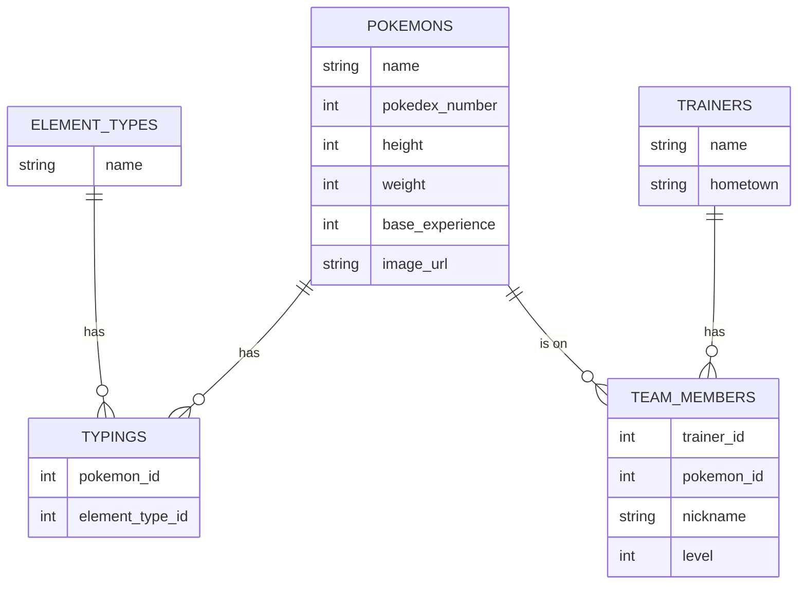

# Pokédex Team Builder

A Ruby on Rails app for browsing the first 151 Pokémon, filtering them by type, and seeing which (fake) trainers have them on their teams. Built for the Rails Intro Project.

## Features

- Browse all Pokémon in a paginated grid (20 per page)
- Search Pokémon by name, and narrow the search to one type with a dropdown
- Pokémon pages showing stats, types, and the trainers who have that Pokémon
- Type pages listing every Pokémon of that type, linking back and forth
- Trainer pages showing each trainer's team
- About page describing the data sources
- Bootstrap grid layout and a menu on every page

## Data sources

| Source | Format | Used for |
|--------|--------|----------|
| [PokeAPI](https://pokeapi.co) `/type` | JSON | The 18 element types (`element_types`) |
| [PokeAPI](https://pokeapi.co) `/pokemon` | JSON | 151 Pokémon and their types (`pokemons`, `typings`) |
| [Faker](https://github.com/faker-ruby/faker) gem | Generated | 20 trainers and their teams (`trainers`, `team_members`) |

The seed script creates about 527 rows in total.

## Database



- **Many-to-many:** Pokémon ↔ element types (through `typings`), and Pokémon ↔ trainers (through `team_members`).
- **One-to-many:** a trainer has many team members.
- `ElementType` is named that because `type` is a reserved column name in Rails.

## Setup

Requires Ruby and Rails (built with Rails 8.1).

```bash
git clone https://github.com/gjootun/pokedex_app.git
cd pokedex_app
bundle install
rails db:migrate
rails db:seed     # about a minute or two: it makes 151 calls to PokeAPI
rails server
```

Then open http://localhost:3000.

## Gems used

- `kaminari` for pagination
- `faker` for fake trainer data
- Bootstrap 5 (loaded from a CDN) for layout
